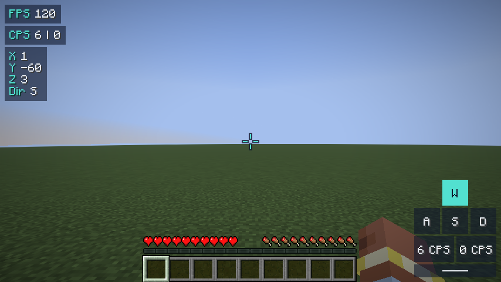
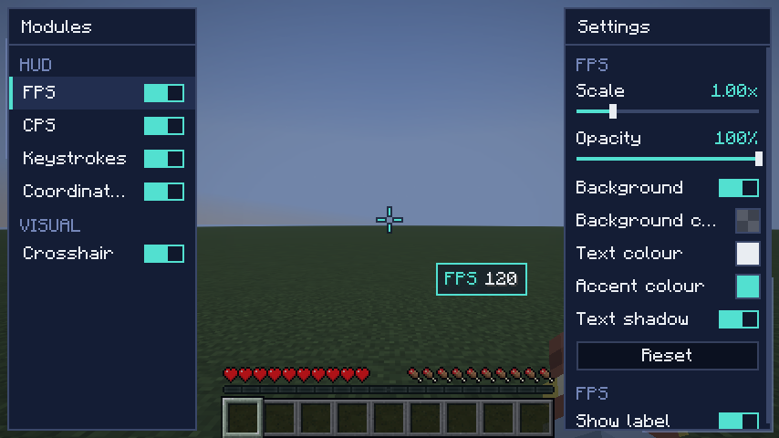

<p align="center"></p>

# Cobalmoon Client

Cliente PvP **gratuito y de código abierto** para Minecraft: Java Edition. Ultra personalizable, sin anuncios, sin
telemetría y sin tienda. Compatible con mods de Fabric e instalaciones existentes.

> Cobalmoon Client no está afiliado a Mojang ni a Microsoft. «Minecraft» es una marca de Mojang Synergies AB.
> El launcher descarga el juego de los servidores oficiales de Mojang; no redistribuimos su código ni sus assets.

## Estado: Fase 5 (beta)

**Fase 5: diferenciadores** ([detalles](docs/phase5.md)):
- **Análisis post-pelea:** comparado con tus peleas anteriores.
- **Replay ligero:** las últimas 10 peleas en un mapa con línea de tiempo.
- **Modo entrenamiento:** CPS, puntería al strafear, W-tap y bridging. Solo mide, nunca juega por ti.
- **Perfiles automáticos por servidor.**
- **Configuraciones compartibles:** con un código `CBM1:…`.

### Fase 4

**Fase 4: módulos PvP completos** ([detalles](docs/pvp-modules.md)):
- **HUD:** ping, combo, reach, críticos, armadura, efectos, cooldown y temporizadores.
- **Visual:** zoom (`C`), color de golpe, fuego y escudo bajos, sin niebla, partículas y hitsounds.
- **Juego:** toggle sprint, atajos de hotbar y mensajes automáticos.
- **[Modo Servidor Seguro](docs/safe-server-mode.md):** opcional, desactivado por defecto y nunca bloquea nada.

### Fase 3

**Fase 3:** importar instalaciones existentes y compatibilidad con mods ([detalles](docs/compatibility.md)):
- Detecta e importa el launcher oficial, Prism/MultiMC, CurseForge, Modrinth App, cualquier carpeta y `.mrpack`, en su sitio (sin tocar sus mods) o como copia.
- Añade cualquier `.jar`, busca e instala mods de Modrinth con dependencias, y trae un preset PvP de rendimiento.
- Probado en el juego real junto a Sodium, Iris, Lithium, Mod Menu, ReplayMod y Xaero's Minimap, y con un modpack real de 60 mods.

### Fase 2

<p align="center"> </p>

| Funciona | Falta (próximas fases) |
|---|---|
| **Módulos** activables en caliente, con ajustes que se guardan solos (`config/cobalmoon/`) | ✅ Hecho en la fase 4 |
| **5 módulos:** FPS, CPS, Keystrokes, Coordenadas, Crosshair personalizable | |
| **Editor de HUD** (`Shift derecho`): arrastrar con imán, rueda para escalar, multiselección, flechas, opacidad, colores, fondo y sombra por elemento | Perfiles de HUD compartibles por código — fase 5 |
| Interfaz in-game con la paleta Cobalmoon y opción de reducir animaciones | Editor de temas — fase 6 |
| API pública de módulos para addons ([guía](docs/modules.md)) | Scripts Lua — fase 6 |
| Launcher Tauri: perfiles, login Microsoft (OAuth + PKCE), descargas verificadas de Mojang/Fabric | Login real: client ID de Azure aprobado ([guía](docs/azure-app.md)) |
| Mod núcleo para **26.3** y **1.21.11** | 1.8.9 — después de v1.0 |

### Atajos del editor de HUD

| Acción | Cómo |
|---|---|
| Abrir / cerrar | `Shift derecho` / `Esc` (configurable en Controles) |
| Mover | Arrastrar (se imanta a bordes, centro y otros elementos) · flechas: 1 px, `Shift`+flechas: 10 px |
| Escalar | Arrastrar el tirador turquesa de la esquina, o rueda del ratón sobre el elemento |
| Varios a la vez | `Shift`+clic |
| Restablecer | `R` o botón *Restablecer* |
| Vista limpia (solo el HUD) | Botón «Editar HUD» arriba (o `Tab`); «Volver a ajustes» para regresar |
| Cambiar un color | Clic en la fila de color → rueda de color con brillo, transparencia y paleta (clic derecho: siguiente color de la paleta) |
| Activar módulos y ajustes | Panel izquierdo (interruptor) y panel derecho |

Arquitectura y plan completo: [docs/ARCHITECTURE.md](docs/ARCHITECTURE.md).

## Estructura

```
api/            API pública para addons (LGPL-3.0)
client-core/    Mod Fabric: src/ compartido + versions/<mc>/ por versión de Minecraft
design-tokens/  tokens.json (fuente única de la paleta), logo, scripts de generación y contraste
launcher/       Launcher Tauri 2 (Rust en src-tauri/, Svelte 5 en ui/)
docs/           Arquitectura, tokens, guía de Azure
```

## Compilar

Requisitos: JDK 25 y JDK 21, Node 22+, Rust estable y, en Windows, Visual Studio C++ Build Tools.

```bash
./gradlew build
```

```bash
cd launcher && npm ci && npm run tauri dev
```

Probar el mod sin el launcher (perfil de desarrollo de Fabric, sin cuenta):

```bash
./gradlew :client-core:mc-26.3:runClient
```

Instaladores (`.msi`, `.dmg`, `.AppImage`, `.deb`): `cd launcher && npm run tauri build` (antes, `./gradlew build`).

## Tests

```bash
node --test design-tokens/scripts/ && node design-tokens/scripts/check-contrast.mjs
```

```bash
./gradlew test
```

Prueba en el juego real (crea un mundo, usa los módulos y el editor y guarda capturas en `client-core/versions/<mc>/build/run/clientGameTest/screenshots`):

```bash
./gradlew :client-core:mc-26.3:runClientGameTest
```

La misma prueba junto a Sodium, Iris, Lithium, Mod Menu, ReplayMod y Xaero's Minimap (versiones fijadas con SHA-512):

```bash
./gradlew :client-core:mc-26.3:runClientGameTest -Pcompat
```

Comprobaciones con datos reales: detecta tus instalaciones (solo lectura) y usa la API de Modrinth:

```bash
cd launcher/src-tauri && cargo test --test live -- --ignored --nocapture
```

Probar la interfaz del launcher en el navegador, con datos de ejemplo y sin backend: `cd launcher && npm run dev` y abre http://localhost:1420.

```bash
cd launcher && npm run check && npm test
```

```bash
cd launcher/src-tauri && cargo test
```

Prueba de humo real (descarga ~500 MB de Mojang/Fabric y arranca el juego con el comando del launcher):

```bash
cd launcher/src-tauri && COBALMOON_SMOKE_RUN=1 cargo test --test launch_smoke -- --ignored --nocapture
```

## Crear un addon

Cualquier mod de Fabric puede añadir módulos declarando el entrypoint `cobalmoon` y registrándolos con
`api.modules().register(...)`. Guía completa con ejemplo: [docs/modules.md](docs/modules.md).

## Filosofía

El cliente no bloquea ni censura lo que instales. No incluye cheats ni nada para evadir anticheats. El «Modo
Servidor Seguro» solo avisa y viene desactivado. Sin telemetría.

## Licencia

- Launcher, núcleo y módulos: [GPL-3.0-or-later](LICENSE)
- `api/`: [LGPL-3.0-or-later](api/LICENSE), para que los addons usen la licencia que quieran
